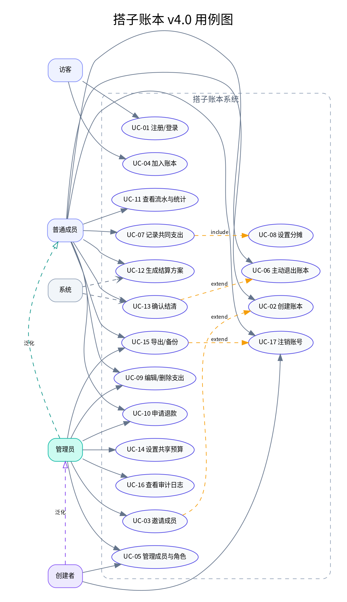
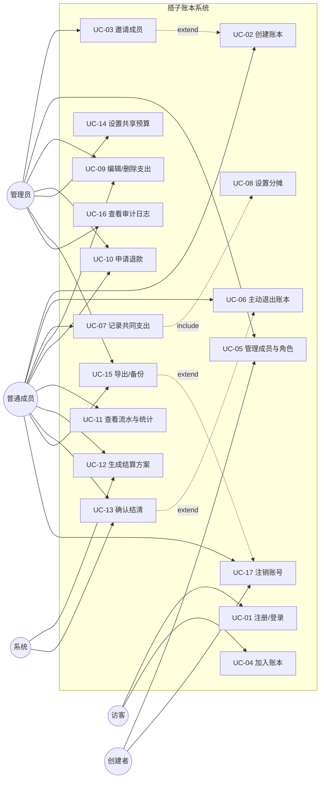
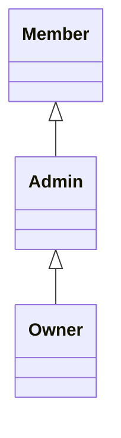
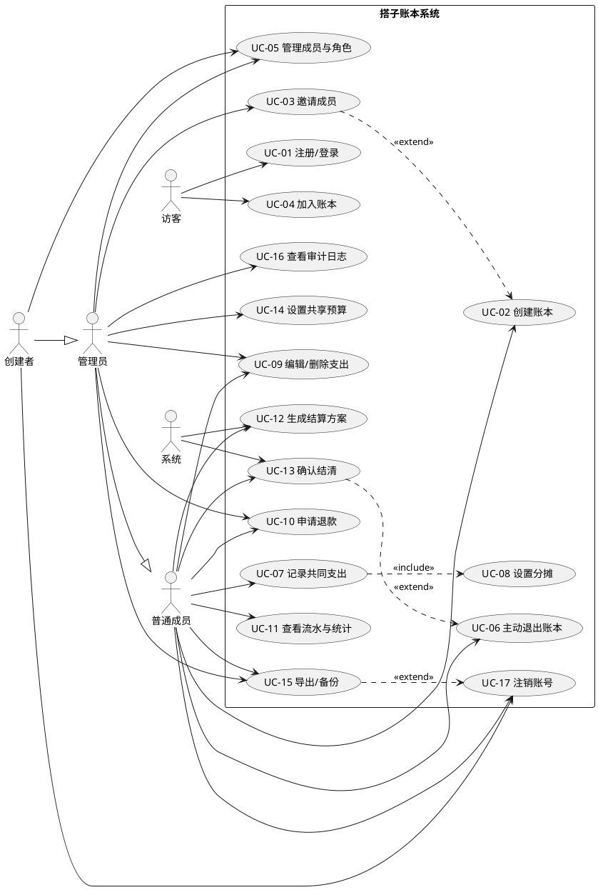

# 搭子账本 v4.0 · 用例图

## 1. 用例图（Mermaid）

## 2. 参与者泛化

> 含义：Owner 继承 Admin，Admin 继承 Member。高权限角色拥有低权限角色的能力，同时受权限矩阵中的明确限制（例如 Admin 不能移除 Admin）。

## 3. 用例关系说明

| 关系 | 源 | 目标 | 方向说明 |
|---|---|---|---|
| include | UC-07 记录共同支出 | UC-08 设置分摊 | 记录支出必然执行分摊，分摊是必选的子功能 |
| extend | UC-03 邀请成员 | UC-02 创建账本 | 创建账本后可选择立即邀请，邀请是可选扩展 |
| extend | UC-13 确认结清 | UC-06 主动退出账本 | 退出时若余额不为 0，先触发结清；余额为 0 则不触发 |
| extend | UC-15 导出/备份 | UC-17 注销账号 | 注销前可选导出数据，非必经流程 |

**include 与 extend 的区别**：

- `include`：基础用例**必须**执行被包含用例，箭头从基础用例指向被包含用例；
- `extend`：扩展用例在特定条件下**可选**插入基础用例，箭头从扩展用例指向基础用例；
- 本图中，记录支出一定要分摊（include）；创建后邀请、退出前结清、注销前导出都是条件触发（extend）。

## 4. 为什么没有画“继承”用例

用例之间的继承（generalization）表示一个用例是另一个用例的特化版本。本项目没有“相似但改写部分动作”的用例对，因此用例之间只使用 include 和 extend；参与者之间才存在泛化关系（Member → Admin → Owner）。

## 5. PlantUML 版本（可选）

如果博客平台不支持 Mermaid，可使用以下 PlantUML 源码：

## 6. 覆盖检查

| 检查项 | 结果 |
|---|---|
| 每个参与者至少关联一个用例 | 是 |
| 每个 FR 至少对应一个用例 | 是（见 `用例信息.md` 第 5 节） |
| include/extend 方向正确 | 是 |
| 参与者泛化关系正确 | 是 |
| 系统边界清晰 | 是，矩形内为系统用例，矩形外为参与者 |
| 是否包含 CRUD 过度拆分 | 否，编辑与删除合并，退款独立 |
