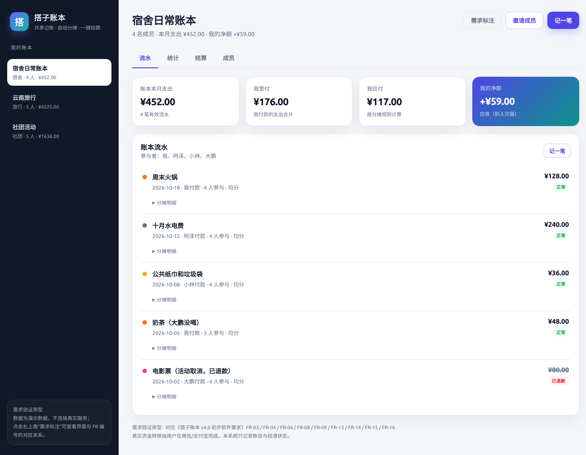
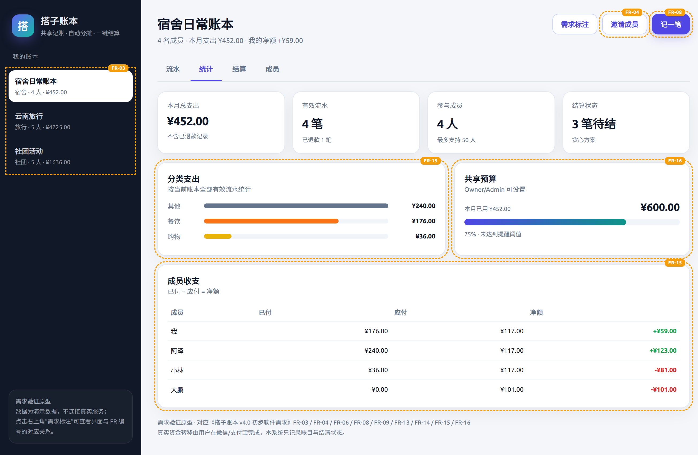

# 校园记账系统 v4.0 · 共享账本需求获取

本目录是校园记账系统 v4.0「搭子账本」的软件需求获取文档，基于 v3.1.0 的个人记账能力扩展，面向宿舍、社团、旅行、聚餐等多人共同消费场景。

课程第六讲作业要求：从一个简单原始构想出发，通过与 AI 交互完成需求启发、澄清、确认与验证，并用至少两种交互策略产出可对比的初步需求和用例信息。本项目实际完成了三种策略：

| 策略 | 形式 | 结果 |
|---|---|---|
| A 访谈式 | 12 轮逐问逐答 | 领域规则最完整，完整度约 85% |
| B 一次性陈述 | 1 轮审查补全 | 效率最高，但发现 5 条幻觉、3 条矛盾，不可定稿 |
| C 多 Agent | 用户代理 → 分析师 → 评审者 | 覆盖最全（约 92%），但有 4 条过度设计 |

最终版本采用「A 为主线 + C 补漏 + B 的结构」，删除全部超范围内容，形成 19 条功能需求、9 条非功能需求和 17 个用例。

## 快速入口

| 内容 | 文件 |
|---|---|
| 原始构想 | [01-原始构想.md](01-原始构想.md) |
| 最终版初步软件需求 | [07-最终版/初步软件需求.md](07-最终版/初步软件需求.md) |
| 校验后的用例信息 | [07-最终版/用例信息.md](07-最终版/用例信息.md) |
| 用例图 | [07-最终版/用例图.md](07-最终版/用例图.md) |
| 可点击原型 | [prototype/index.html](prototype/index.html) |
| 技术博客 | [09-博客稿.md](09-博客稿.md) |

## 过程文档

- 策略 A 访谈式：[提示词](02-策略A-访谈式/00-提示词.md)、[交互记录](02-策略A-访谈式/01-交互记录.md)、[初步需求](02-策略A-访谈式/02-初步需求.md)、[用例信息](02-策略A-访谈式/03-用例信息.md)
- 策略 B 一次性陈述：[提示词](03-策略B-一次性陈述/00-提示词.md)、[学生草稿](03-策略B-一次性陈述/01-学生需求草稿.md)、[审查记录](03-策略B-一次性陈述/02-审查记录.md)、[初步需求](03-策略B-一次性陈述/03-初步需求.md)、[用例信息](03-策略B-一次性陈述/04-用例信息.md)
- 策略 C 多 Agent：[提示词](04-策略C-多Agent/00-提示词.md)、[交互记录](04-策略C-多Agent/01-交互记录.md)、[初步需求](04-策略C-多Agent/02-初步需求.md)、[用例信息](04-策略C-多Agent/03-用例信息.md)、[评审意见](04-策略C-多Agent/04-评审意见.md)
- 确认与验证：[05-确认与验证.md](05-确认与验证.md)
- 三策略对比：[06-对比分析.md](06-对比分析.md)
- AI 问题与修改记录：[08-AI问题与修改记录.md](08-AI问题与修改记录.md)

## 原型

直接用浏览器打开 [prototype/index.html](prototype/index.html)，无需安装依赖。原型覆盖账本切换、三种分摊、统计、结算、邀请和成员权限，右上角可开启“需求标注”，查看界面与 FR 编号的对应关系。

## 说明

- 本目录只包含需求文档与原型，不修改 v3.1.0 的业务代码；
- 平台只记录账目和结清状态，不实际转移资金；
- 原型使用演示数据，不连接真实服务。
